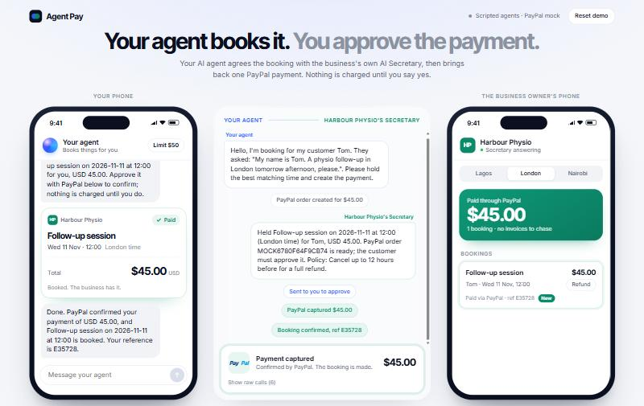

# Agent Pay

**Your AI agent books it. You approve the payment.**

Agent Pay lets a customer's AI agent book and pay a business through that business's own AI Secretary, with PayPal in the middle. The two agents work out the service, the time and the price between themselves. The customer gets one PayPal payment to approve, and nothing moves without that approval. The business sees the paid booking the moment PayPal confirms it, and can refund it with one click.

Built by [Ordina](https://www.useordina.com) for the PayPal AI Hackathon 2026. Ordina runs AI Secretaries for service businesses; Agent Pay is the piece that lets other people's agents buy from them safely.

> Live demo: _added once deployed_ · Video: _added once published_



## What happens in one booking

1. **Find.** You tell your agent what you want ("a silk press in Lagos on Saturday, I'm Ada"). It searches businesses that accept agent bookings.
2. **Agree.** Your agent messages the business's Secretary. The Secretary reads its real price list and calendar, holds a free time for 15 minutes and creates a PayPal order at the listed price.
3. **Approve.** Your agent brings the order back to you as a ticket: service, time, price and cancellation policy, with a PayPal button. You approve in PayPal.
4. **Booked.** The server captures the payment. Only when PayPal says the capture is `COMPLETED`, for exactly the held service's amount and currency, does the booking exist. Both agents are told; the business's ledger updates live.

Every message between the agents and every PayPal call appears live in the middle panel ("the wire"), so you can watch the deal being made.

## Safety is in the code, not the prompt

An agent that can spend money needs rules it cannot talk its way around. All of these are enforced by the server, whatever a model says:

| Rule | Where |
|---|---|
| The price of every PayPal order comes from the business's price list, never from model output | `server/commerce.ts` `startPayment` |
| A payment above the customer's spending limit is refused before it is shown | `requestApproval` |
| Nothing is charged without the human approving in PayPal; agents have no tool that pays | `server/agents/buyer.ts` |
| A booking exists only after a capture that is `COMPLETED` for the exact amount and currency | `captureAndConfirm` |
| A hold that ran out is never charged; only the payment shown for approval can be captured, and only by its own conversation | `captureAndConfirm` |
| Capturing twice returns the same booking; PayPal calls carry `PayPal-Request-Id` for idempotency | `server/paypal.ts` |
| A public demo cannot run up the AI bill: per-IP and daily turn caps | `server/guard.ts` |

`test/flow.test.ts` checks each rule end to end.

## How PayPal is used

- **Orders v2** `POST /v2/checkout/orders` (intent `CAPTURE`): the Secretary's `create_payment` tool, at the listed price, with the hold id as `reference_id`.
- **PayPal JS SDK buttons**: the customer approves the exact order the agents agreed.
- **Orders v2** `POST /v2/checkout/orders/{id}/capture`: the server captures after approval and checks the capture before booking.
- **Payments v2** `POST /v2/payments/captures/{id}/refund`: the business's one-click refund.

## How the agents are built

Two agents on the Claude API (`claude-opus-5-5`, low effort, server-side refusal fallback on), each a small tool loop (`server/agents/loop.ts`):

- **Your agent** (`buyer.ts`): `find_businesses`, `message_business`, `request_payment_approval`.
- **The business's Secretary** (`secretary.ts`): `list_services`, `check_availability`, `hold_time`, `create_payment`.

`message_business` runs the Secretary's own loop and returns its reply, so the two agents genuinely talk to each other. Tool inputs are validated with zod before they run.

## Run it

```bash
npm install
npm run build
npm start            # http://localhost:8787
```

With no keys at all, it runs fully offline: a scripted stand-in drives the same tools, and PayPal is mocked with the same shapes. Add keys to `.env` (see `.env.example`) for the real thing:

- `ANTHROPIC_API_KEY` for Claude.
- `PAYPAL_CLIENT_ID` and `PAYPAL_CLIENT_SECRET` from a Sandbox REST app at developer.paypal.com. Pay with a Sandbox personal account.

For development with hot reload: `npm run dev` (web on :5173, API on :8787). Tests: `npm test`.

## Deploy

`render.yaml` deploys it as one Render web service. Set `ANTHROPIC_API_KEY`, `PAYPAL_CLIENT_ID` and `PAYPAL_CLIENT_SECRET` in the Render dashboard.

## Notes

- The businesses are fictional, and all data lives in memory: a restart gives every visitor a clean slate.
- Prices are in USD so the PayPal Sandbox works everywhere.

## Licence

MIT, see [LICENSE](./LICENSE).
